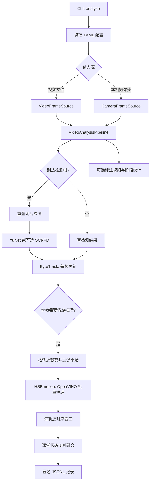

# Classroom Emotion 项目架构

## 项目定位

本项目是一个面向教室视频的离线分析 PoC：从摄像头或视频读取画面，检测人脸、为轨迹分配匿名 ID、估计表情概率，并将多帧信息融合成保守的课堂可观察状态。身份 embedding 仅用于本次运行内的人脸重识别，不解析姓名，也不默认保存原始画面。

主要推理路径运行在 OpenVINO 上。默认检测模型为 OpenCV Zoo YuNet，默认情绪模型为 EmotiEffLib HSEmotion；ByteTrack 负责跨帧关联。

## 总体数据流

## 一帧如何处理

1. **读取输入。** `VideoFrameSource` 为文件视频生成带帧序号和时间戳的帧；`CameraFrameSource` 打开本机摄像头，并尝试按配置设置分辨率和帧率。
2. **按间隔检测。** `VideoAnalysisPipeline` 按 `detection.interval_frames` 调用检测器。默认每 2 帧检测一次。`TiledFaceDetector` 默认将画面划为 2×2 个有重叠区域分别检测，再将框和五点关键点映射回原图并执行 NMS。
3. **每帧跟踪。** 检测帧之间也会调用跟踪器；没有新检测的帧传入空检测结果，使 ByteTrack 的状态按视频帧推进。轨迹 ID 只在本次运行中使用，不代表学生身份。
4. **按需进行情绪推理。** 只在检测帧且帧序号满足 `emotion.interval_frames` 时，对有效轨迹裁剪人脸。匹配到五点关键点时先做对齐；无法对齐时退回人脸框裁剪。小于配置最小边长的裁剪会跳过；其余裁剪合并成批次，交给 OpenVINO HSEmotion。
5. **更新轨迹状态。** 表情概率与时间戳、图像质量和可用的人脸线索写入轨迹窗口。窗口按时间长度保留数据，并以质量加权的方式聚合概率；可选 Face Landmarker 提供闭眼和眉部下压线索。
6. **写出结果。** 状态达到最小观测数后由规则映射为课堂状态；证据不足时保留 `unknown`。结果通过回调写入 JSON Lines，也可通过回调生成带框的视频。

默认检测间隔为 2 帧、情绪间隔为 6 帧。由于情绪推理还要求该帧同时是检测帧，所以默认通常每 6 帧推理一次，而跟踪器仍逐帧更新。

## 主要模块

| 模块 | 职责 |
| --- | --- |
| `src/classroom_emotion/cli.py` | `probe`、`export-openvino`、`make-sample`、`analyze`、`evaluate` 命令；根据配置创建输入源、模型后端、管线和输出器。 |
| `config.py`、`configs/default.yaml` | 类型化配置与默认参数：输入规格、设备、检测/跟踪/情绪频率、时序窗口和输出策略。 |
| `video.py` | 视频文件、摄像头帧源以及可选的标注视频写入。 |
| `detection/yunet.py` | YuNet 的 OpenVINO 执行、输出解码和坐标还原。 |
| `detection/detector.py`、`detection/scrfd.py`、`detection/geometry.py` | 检测器接口、可选 SCRFD 后端、切片检测、letterbox 和 NMS 等几何处理。 |
| `detection/cues.py` | 从五点人脸关键点计算粗略低头线索。 |
| `inference/emotion.py`、`inference/batching.py` | 合成人工测试后端、HSEmotion 预处理和 OpenVINO 批量推理规划。 |
| `inference/identity.py` | OpenVINO 人脸重识别 embedding、五点对齐和内存内特征提取。 |
| `tracking/bytetrack.py` | 项目数据结构、Supervision ByteTrack 适配与短期稳定 ID 重识别。 |
| `pipeline.py` | 编排逐帧检测、跟踪、裁剪、分类、状态更新、回调和耗时统计。 |
| `temporal.py`、`track_state.py`、`state_fusion.py` | 按轨迹维护时间窗口、过期清理、概率聚合及课堂状态规则映射。 |
| `domain.py`、`output.py` | 共享数据契约、状态枚举和匿名 JSONL 序列化。 |
| `runtime.py` | 查询 OpenVINO 版本、可用设备和设备能力。 |

## 模型与推理后端

- **YuNet：**默认人脸检测模型，ONNX 文件为 `models/weights/yunet.onnx`，来源和 SHA-256 记录在 [`models/manifest.yaml`](../models/manifest.yaml)。
- **HSEmotion：**默认情绪分类模型 `enet_b0_8_best_vgaf`，ONNX 文件为 `models/weights/hsemotion.onnx`。代码将 BGR 裁剪转为 RGB、缩放到 224×224，并应用 ImageNet 均值和标准差归一化。
- **Face re-identification：**Open Model Zoo `face-reidentification-retail-0095`，需本地提供 XML/BIN。输入为 128×128 BGR 对齐人脸，输出 256 维特征。特征仅在内存中保留，并于分析结束或超过身份保留时长后清除；匹配有歧义时创建新 ID。
- **SCRFD：**保留可选 OpenVINO 后端。需要显式选择 `detection.model: scrfd_2_5g` 并提供兼容模型；清单标记了权重许可审核要求，未作为默认模型。
- **ByteTrack：**由 `supervision` 可选依赖提供，不是神经网络推理模型，也不在 OpenVINO 上执行。
- **OpenVINO 设备：**通过 `--device` 选择，例如 `GPU` 或 `CPU`。是否可用取决于设备、驱动、OpenVINO 插件及具体模型算子支持。

默认配置见 [`configs/default.yaml`](../configs/default.yaml)。模型文件位于被 Git 忽略的 `models/weights/` 下，需要单独获取；项目不会在运行时隐式下载权重。人脸 embedding 属于敏感生物特征，使用前需完成适用的授权、告知、访问与保留评估。

## 状态融合与输出

HSEmotion 输出基础表情概率；它不直接输出“投入、专注或困惑”等教学结论。`ClassroomStateFusion` 基于时间聚合后的概率和线索进行规则映射：开心/惊讶概率达到阈值可映射为 `engaged`，中性概率达到阈值可映射为 `attentive`；证据不足时为 `unknown`。

YuNet 的五点关键点用于人脸对齐及粗略头部姿态线索；启用 Face Landmarker 且提供其模型资产时，还可估计闭眼与眉部下压线索。持续低头、疑似手机使用、困惑和闭眼状态都是需要人工核实的候选。`phone_use_cue` 不代表检测到了手机或手部；HSEmotion 标签也没有显式 `confused` 类别。状态是基于可观察图像线索的启发式估计，不等同于学生真实心理状态。

默认结果写入 `outputs/predictions.jsonl`。每条记录包含匿名 `track_id`、时间戳、课堂状态、表情概率、观测数和证据；默认还包含人脸框。原始视频不默认写盘；只有显式提供 `--annotate` 才会生成标注视频。输出记录仍可能属于敏感的学生数据，应限制其访问和保留时间。

## 当前验证边界

YuNet 与 HSEmotion 已在项目当前 Intel Arc 140T / OpenVINO GPU 环境完成模型级推理验证。该验证不代表真实课堂准确率、远距离小脸召回、轨迹稳定性或摄像头实时性能已达标；这些指标仍需用目标摄像头和经授权的代表性视频测量。

## 参考的 GitHub 开源项目

| 项目 | 地址 | 在本项目中的用途 |
| --- | --- | --- |
| OpenCV Zoo - YuNet | [github.com/opencv/opencv_zoo](https://github.com/opencv/opencv_zoo/tree/main/models/face_detection_yunet) | 默认人脸检测模型及其模型说明。 |
| EmotiEffLib - HSEmotion | [github.com/sb-ai-lab/EmotiEffLib](https://github.com/sb-ai-lab/EmotiEffLib) | 默认情绪分类模型 `enet_b0_8_best_vgaf` 的来源。 |
| Supervision | [github.com/roboflow/supervision](https://github.com/roboflow/supervision) | 提供项目跟踪适配器调用的 `ByteTrack` 实现。 |
| OpenVINO | [github.com/openvinotoolkit/openvino](https://github.com/openvinotoolkit/openvino) | 加载并在 Intel CPU/GPU 等设备上执行兼容模型。 |
| InsightFace / SCRFD | [github.com/deepinsight/insightface](https://github.com/deepinsight/insightface/tree/master/detection/scrfd) | 可选的人脸检测后端；不是默认路径，预训练权重需要单独进行许可审核。 |
| Open Model Zoo | [github.com/openvinotoolkit/open_model_zoo](https://github.com/openvinotoolkit/open_model_zoo) | 清单中记录的头部姿态模型候选来源；当前尚未接入主推理流程。 |

本项目复用上述模型、运行库或算法实现，并未直接复制其中某个完整应用。各来源的源码许可证不自动覆盖预训练权重和训练数据的使用条款；部署前应分别确认。